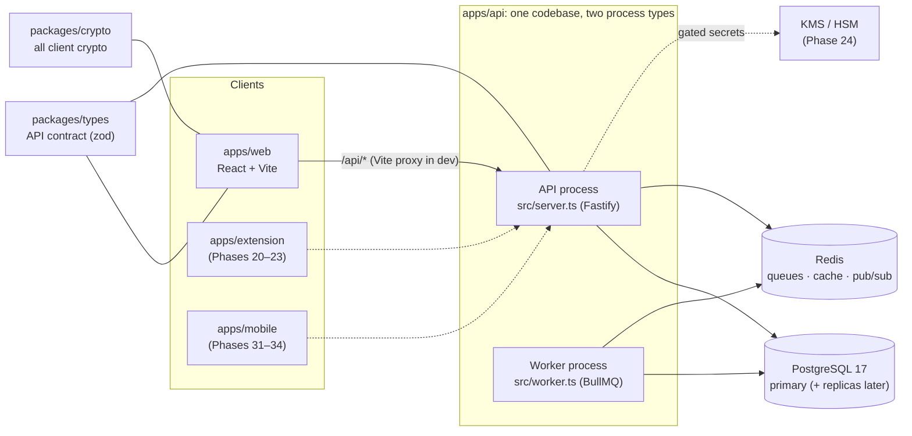
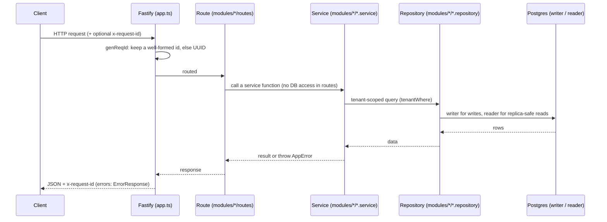
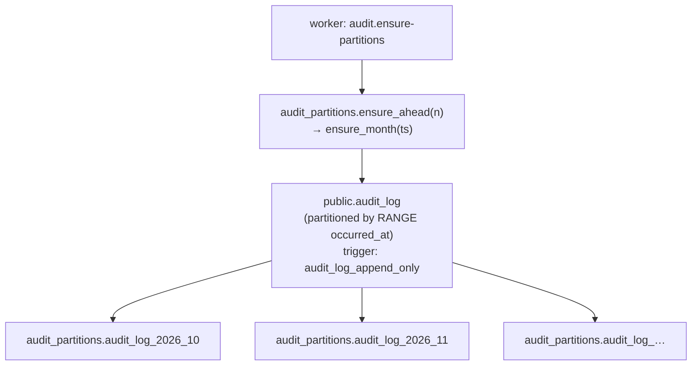

# Architecture

A map of the code **as built**, so you can go straight to the right file.
Update it whenever a file, route, model, job or package is added,
renamed or removed. The *target* design (key hierarchy, grants, clients)
is in `ref/design.md`.

Current state: Phases 1 (crypto core) and 2 (auth API) built, awaiting
verification; Phase 3 (web auth core) in progress. No vault yet.

## 1. System shape



Dashed = planned. The API is stateless and scales horizontally. Workers
scale separately. Both run the same modules.

## 2. Request path (API)



## 3. Repo layout

```
apps/
  api/            Fastify API + BullMQ worker (one package)
  web/            React 19 + Vite 8 + Tailwind 4 + React Router 7
  extension/      README only (Phases 20–23)
  mobile/         README only (Phases 31–34)
packages/
  types/          @repo/types: zod schemas + types shared by API and clients
  crypto/         @repo/crypto: all client crypto (libsodium + WebCrypto HKDF)
docker-compose.yml          Local Postgres :5433 + Redis :6380 + Mailpit (SMTP :1025, UI :8025)
docker/postgres/init/       First-start SQL (creates app_test)
.github/workflows/ci.yml    lint → typecheck → test (with Postgres + Redis) → build
turbo.json                  Task graph (db:generate runs before build/typecheck/test/dev)
tsconfig.base.json          Shared strict TS config (Bundler resolution)
biome.json                  Lint + format
```

Internal packages export TypeScript source (`"exports": "./src/index.ts"`).
There is no package build step. Vite bundles them for web, and tsup
bundles them for api (`noExternal: [/^@repo\//]`).

## 4. API (`apps/api`)

| File | Responsibility |
|---|---|
| `src/server.ts` | API entry: env → logger → Redis → `createModules` → seed legal docs → `buildApp` → listen; graceful shutdown |
| `src/worker.ts` | Worker entry: job schedules, runs the `maintenance` + `email` queues (SMTP delivery), ensures audit partitions on start |
| `src/app.ts` | `buildApp(options)`: Fastify instance from injected deps (logger, trust-proxy hops, health checks, optional `modules`). With modules: cookie → rate-limit → CSRF → auth hook, then auth/mfa/devices/legal routes. No env/DB imports, so tests build the real app |
| `src/modules.ts` | Composition root `createModules({db, redis, config, email})`: builds every module in dependency order. Used by API, worker, integration tests |
| `src/config/env.ts` | zod-validated env. Throws on startup listing every bad var. Imported only by entry points and `db/client.ts` |
| `src/config/security.ts` | `SecurityConfig` (app origin, RP ID, cookie Secure, keys, server hash params) + session/trust/token lifetimes |
| `src/config/legal/` | Published Terms/Privacy versions as TS (`terms.ts`, `privacy.ts`); immutable once seeded |
| `src/plugins/auth.ts` | Auth hook: cookie → `request.auth` (`user`, `session`, `tenant`, `step`, `pendingLegal`) and gates; route `config.auth` (`"public"` / `{allow}`); `requireAuth`, `actorOf` |
| `src/plugins/csrf.ts` | Double-submit CSRF check on unsafe methods; `issueCsrfToken` |
| `src/plugins/rate-limit.ts` | `@fastify/rate-limit` (Redis store); `rateLimits(app, rules)` preHandler for multi-key limits (`byIp`, `byEmail`, `byUser`) |
| `src/lib/secrets.ts` | Server-side: random tokens, SHA-256, HMAC, constant-time compare, Argon2id PHC hash/verify (`node:crypto`), dummy verifier, AES-256-GCM server secrets |
| `src/lib/totp.ts` | RFC 6238 TOTP, base32, otpauth URI |
| `src/lib/http.ts` | `requestMeta`, cookie names (`__Host-` when Secure) / options, `describeUserAgent` |
| `src/lib/actor.ts`, `src/lib/session-step.ts` | `Actor` (tenant/user/device/session); gate order `sessionStep()` |
| `src/db/errors.ts` | `isUniqueViolation` (Prisma P2002) |
| `src/db/client.ts` | **Only** place `PrismaClient` is built (Prisma 7 + `PrismaPg` adapter). Exports `db: DbHandles` (`writer`, `reader` = replica or writer) and `disconnectDb` |
| `src/db/types.ts` | `Db`, `DbHandles` types for repositories |
| `src/db/tenant.ts` | `Tenant` (`org` / `user`), `orgTenant`, `userTenant`, `tenantWhere` |
| `src/lib/errors.ts` | `AppError` + helpers (`badRequest`, `notFound`, …); `registerErrorHandling` maps AppError / ZodError / Fastify errors to `ErrorResponse`, unknown → 500 |
| `src/lib/logger.ts` | `createLogger`: pino JSON (pretty in dev) with secret redaction; shared by API and worker |
| `src/lib/redis.ts` | `redisOptionsFromUrl`, `createRedis`, `queueConnection` (BullMQ needs `maxRetriesPerRequest: null`) |
| `src/lib/shutdown.ts` | `onShutdown`: SIGINT/SIGTERM → cleanup, forced exit after 10s |
| `src/jobs/queues.ts` | `QUEUES`, `JOBS` names, `createQueue` with default retry/backoff/retention |
| `src/jobs/schedule.ts` | Job name → handler map + repeating schedules (cron, UTC) |
| `src/modules/health/routes.ts` | `GET /health` (liveness), `GET /health/ready` (dependency checks, 2s timeout each, 503 if any fail) |
| `src/modules/audit/` | `index.ts` (public: `createAuditModule`, types), `audit.service.ts` (`record`, `list`, `ensurePartitions`), `audit.repository.ts` (Prisma queries, audit tenant scoping) |
| `src/modules/users/` | User rows + cached per-request `UserState` (Redis `user:state:<id>`: status, security stamp, mfaEnabled) |
| `src/modules/sessions/` | Opaque session tokens: create, `validate` (Redis `sess:<hash>` + `sess:revoked:<hash>` marker, sliding idle), revoke/revokeAll/revokeForDevice, list, cleanup |
| `src/modules/devices/` | Device cookie → device row, trust, list/revoke; routes `/me/devices`, `/me/sessions` |
| `src/modules/legal/` | Seed + catalog (current/required version per key), `pending`, accept; routes `/legal/current`, `/me/legal/accept` |
| `src/modules/email/` | `EmailSender` (queue), templates, SMTP delivery (nodemailer) for the worker |
| `src/modules/mfa/` | TOTP (AES-GCM secret, replay-safe step), WebAuthn (`@simplewebauthn/server`, challenges in Redis), recovery codes (HMAC); routes `/me/mfa/*` |
| `src/modules/auth/` | prelogin, signup, verify email, login/logout, session response, change password, rotate recovery key, recovery; one-time tokens repo; routes `/auth/*`, `/me/password`, `/me/recovery-key` |
| `prisma/schema.prisma` | Data model (Prisma 7: no `url` here, see `prisma.config.ts`) |
| `prisma/migrations/` | Versioned SQL migrations, applied by `prisma migrate deploy` |
| `prisma.config.ts` | Prisma CLI config (schema/migrations path, `DATABASE_URL`) |
| `src/generated/prisma/` | Generated client (gitignored; `pnpm db:generate`) |
| `test/app.test.ts` | App-level tests via `app.inject` with fake health checks |
| `test/integration/` | Real-Postgres tests, skipped unless `TEST_DATABASE_URL` is set. `auth.test.ts` (+ `harness.ts`: cookie-jar client, captured emails) also needs `TEST_REDIS_URL` |
| `test/setup/migrate-test-db.ts` | Vitest global setup: migrates the test DB; refuses if it equals `DATABASE_URL` |

### Routes

| Method + path | Module | Auth | Notes |
|---|---|---|---|
| `GET /health` | health | public | Liveness, never touches dependencies |
| `GET /health/ready` | health | public | `{status, checks: {database, redis}}` |
| `GET /auth/csrf` | auth | public | Sets CSRF cookie, returns token |
| `POST /auth/prelogin` | auth | public, RL ip+email | KDF params + salt (fake, stable for unknown emails) |
| `POST /auth/signup` | auth | public, RL | Always `verification_sent`; doesn't log in |
| `POST /auth/verify-email`, `/verify-email/resend` | auth | public, RL | |
| `POST /auth/login` | auth | public, RL ip+email | Sets session + device cookies; returns `SessionResponse` |
| `GET /auth/session`, `POST /auth/logout` | auth | any step | |
| `POST /auth/mfa/totp`, `/auth/mfa/webauthn/options`, `/verify` | auth | step mfa, RL | TOTP or recovery code; WebAuthn assertion |
| `POST /me/password`, `/me/recovery-key` | auth | ready, RL | |
| `POST /auth/recover/start`, `/complete` | auth | public, RL | |
| `GET /me/mfa`, `POST /me/mfa/totp/setup`, `/confirm`, `/webauthn/register/options`, `/verify` | mfa | mfa_setup or ready | |
| `DELETE /me/mfa/totp`, `/me/mfa/webauthn/:id`, `POST /me/mfa/recovery-codes` | mfa | ready | Last method can't be removed |
| `GET /me/devices`, `DELETE /me/devices/:id`, `GET /me/sessions`, `DELETE /me/sessions/:id` | devices | ready | |
| `GET /legal/current` | legal | public | |
| `POST /me/legal/accept` | legal | step legal | |

Gate order (decisions §11.18): session → user active → MFA verified (if set
up) → legal accepted → MFA set up. Errors `MFA_REQUIRED`,
`LEGAL_ACCEPTANCE_REQUIRED`, `MFA_SETUP_REQUIRED`, `CSRF_INVALID`.

The web app calls these as `/api/health…`. The Vite dev proxy strips
`/api`.

### Jobs (worker)

| Job | Queue | Schedule | Does |
|---|---|---|---|
| `audit.ensure-partitions` | `maintenance` | daily 03:00 UTC + on worker start | Creates audit partitions for this month + 3 ahead (idempotent) |
| `auth.cleanup` | `maintenance` | daily 03:30 UTC | Deletes sessions and one-time tokens dead for > 1 day |
| `email.send` | `email` | on demand | Renders a template and sends via SMTP (Mailpit in dev); removed on completion |

## 5. Data model

| Model (table) | Purpose |
|---|---|
| `AuditLog` (`audit_log`) | Append-only action log. PK `(id, occurred_at)`. Indexed by org+time, actor+time, target. Org rows scoped by `org_id`; personal rows have `org_id` null and are scoped by `actor_user_id` |
| `User` (`users`) | Email, KDF params + salt, `auth_hash` (Argon2id of authKey), encrypted user key, public key, encrypted private key, recovery-wrapped user key, `recovery_auth_hash`, `security_stamp` |
| `Session` (`sessions`) | Token SHA-256, device, `mfa_verified_at`, stamp, idle/absolute expiry, revoked |
| `Device` (`devices`) | Per user + device-cookie hash; `trusted_until`, revoked |
| `MfaTotp` (`mfa_totp`) | AES-GCM secret, `confirmed_at`, `last_used_step` |
| `WebAuthnCredential` (`webauthn_credentials`) | Credential id, COSE key, sign count, transports |
| `MfaRecoveryCode` (`mfa_recovery_codes`) | HMAC of code, `used_at` |
| `OneTimeToken` (`one_time_tokens`) | `email_verify` / `account_recovery`, SHA-256, expiry, used |
| `LegalDocument` / `LegalAcceptance` | Immutable versions (key, version, body sha); acceptances per user (`signup`/`gate`) |

Phase 2 migration: generated by the user with `pnpm db:migrate --name accounts_auth` (not yet created).

### Audit partitioning



- Prisma manages only the `public` schema. Partitions and functions live
  in `audit_partitions`, so `prisma migrate dev` never tries to drop
  them.
- `UPDATE`/`DELETE` raise `audit_log is append-only`. Retention (later)
  = detach + drop whole partitions.
- An insert outside every partition's range fails, which is why the
  worker keeps 3 months ahead.

## 6. Web (`apps/web`)

| File | Responsibility |
|---|---|
| `index.html` + `public/theme-init.js` | Shell; sets the theme before first paint (external script, CSP-friendly) |
| `src/main.tsx` | Mounts `ThemeProvider` + `RouterProvider` |
| `src/router.tsx` | Route table |
| `src/layout/AppShell.tsx` | Top bar (name + theme toggle), side nav, `<Outlet/>`, footer API status |
| `src/theme/` | `theme.ts` (rules, storage key `app.theme`), `ThemeProvider.tsx` (`useTheme`), `ThemeToggle.tsx` |
| `src/components/ApiStatus.tsx` | Calls `/api/health/ready` and shows ok / degraded / offline |
| `src/pages/` | `Placeholder.tsx` (future pages), `NotFound.tsx` |
| `src/index.css` | Tailwind + design tokens (`--bg`, `--surface`, `--fg`, `--muted`, `--line`, `--accent`, `--ok`, `--bad`) for light and dark. Use `bg-surface`, `text-muted`… never raw colors |
| `src/config.ts` | Re-exports `APP_NAME` (from `@repo/types`); `AUTO_LOCK_MS`, `MIN_PASSWORD_LENGTH` |
| `src/api/client.ts` | `request()`: credentials, CSRF header (refetch once on `CSRF_INVALID`), `ApiError`, `onUnauthorized` listeners, `errorMessage` |
| `src/api/auth.ts` | Typed endpoint calls (`authApi`, `mfaApi`, `devicesApi`, `legalApi`), responses parsed with `@repo/types` |

Web auth UI: Phase 3 (crypto worker, AuthProvider, guards, signup/login/
lock) in progress, see `plan/phase-03-web-auth-core/README.md` → Resume
point; MFA + recovery pages Phase 4; Settings → Security + legal gate Phase 5.

| Path | Page | Phase |
|---|---|---|
| `/` | → `/vault` | |
| `/vault` | Placeholder | 8 |
| `/orgs` | Placeholder | 16 |
| `/settings` | Placeholder | 5 |
| `*` | NotFound | |

## 7. Shared packages

| Package | Exports |
|---|---|
| `@repo/types` | Health, errors (+ gate codes), audit; `common.ts` (Email, Key32, Salt16, EncryptedBlob, Token, IdParams), `auth.ts` (KdfParams, prelogin/signup/login/session/password/recovery), `mfa.ts`, `devices.ts`, `legal.ts`, `brand.ts` (`APP_NAME`) |
| `@repo/crypto` | `ready()`; Argon2id `deriveMasterKey`, HKDF `deriveSubKeys` (WebCrypto); XChaCha20-Poly1305 `encrypt`/`decrypt` (`v1.xc20p.<nonce>.<ct>`, header bound as AAD); `wrapKey`/`unwrapKey`; X25519 `generateKeyPair`, `seal`/`openSealed` (`v1.x25519sealed.<ct>`); recovery key (Crockford base32); account flows in `account.ts`; known-answer vectors in `test/vectors/` |

## 8. Config & environments

| Var (apps/api/.env) | Used by | Notes |
|---|---|---|
| `NODE_ENV`, `HOST`, `PORT`, `LOG_LEVEL` | server, worker | dev = pretty logs |
| `DATABASE_URL` | db/client, Prisma CLI | primary |
| `DATABASE_REPLICA_URL` | db/client | optional; unset = reads use primary |
| `REDIS_URL` | server, worker | `redis://` or `rediss://` |
| `TRUST_PROXY_HOPS` | app.ts | real proxy hop count; 0 ignores X-Forwarded-For |
| `APP_ORIGIN` | security config | Web origin: WebAuthn origin/RP ID, email links; https → Secure `__Host-` cookies |
| `SERVER_ENCRYPTION_KEY` | security config | 32 bytes base64; AES-GCM for TOTP seeds (until KMS) |
| `SERVER_HMAC_KEY` | security config | ≥ 32 bytes base64; fake prelogin salts, recovery code hashes |
| `MAIL_HOST`, `MAIL_PORT`, `MAIL_SECURE`, `MAIL_USER`, `MAIL_PASSWORD`, `MAIL_FROM` | worker | SMTP; dev = Mailpit (127.0.0.1:1025) |
| `TEST_DATABASE_URL` | integration tests | must differ from `DATABASE_URL` |
| `TEST_REDIS_URL` | integration tests | separate Redis DB number; flushed by the tests |

Deploy order: `pnpm db:deploy` (release step) → start API (`start`) and
worker (`start:worker`) processes. Node ≥ 24.7 (built-in `crypto.argon2`).
