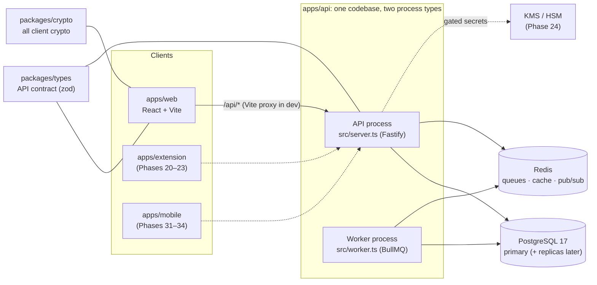
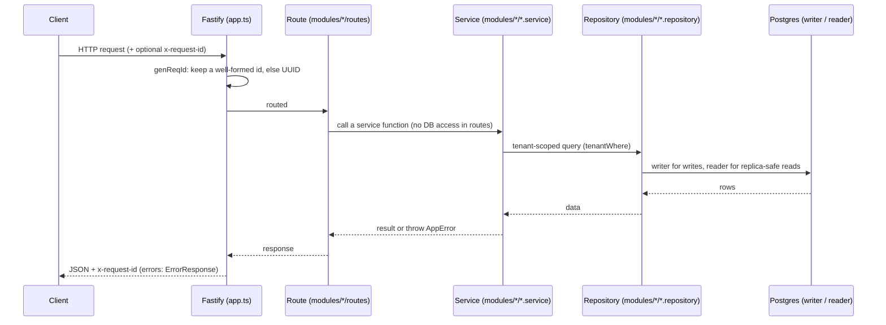
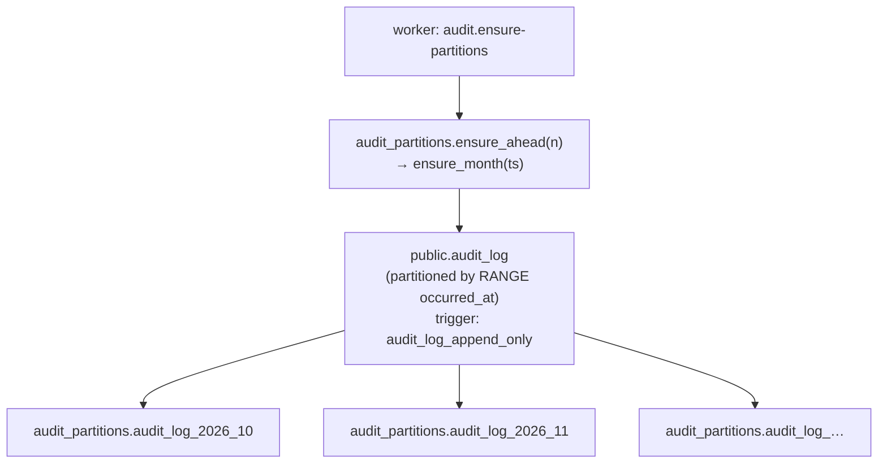
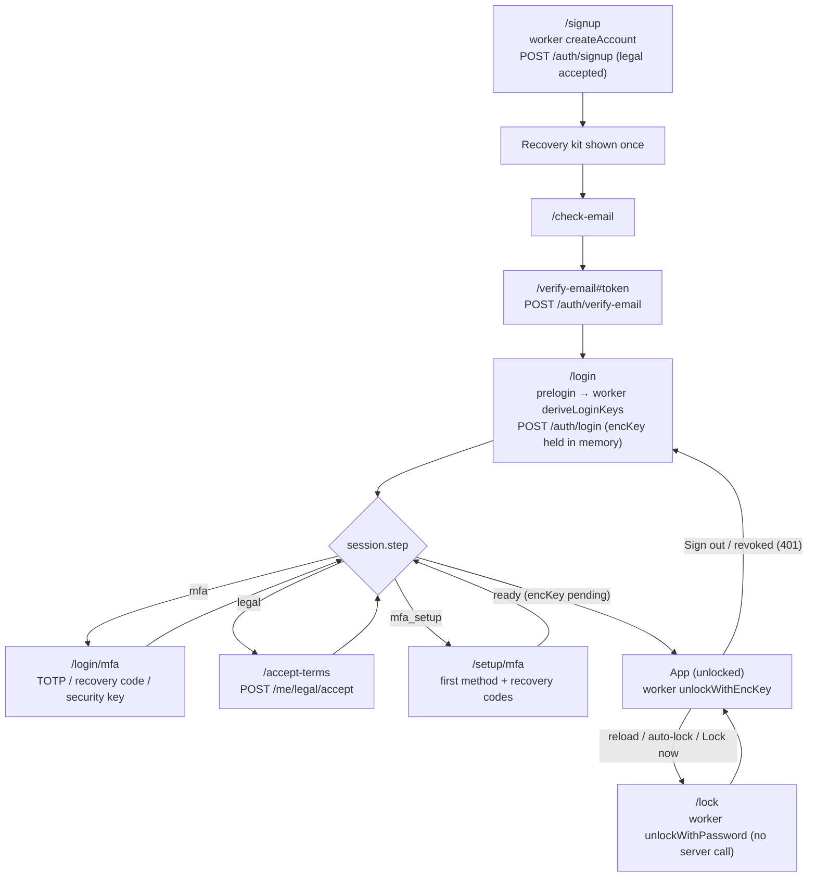
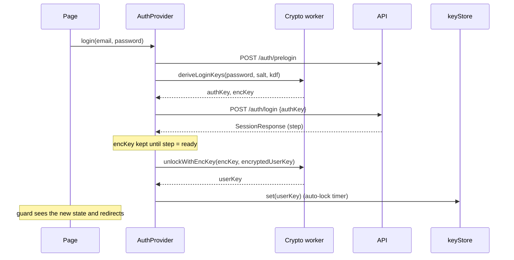
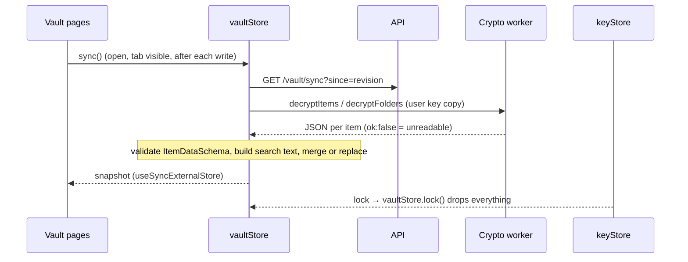
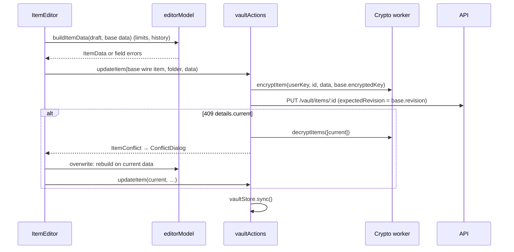
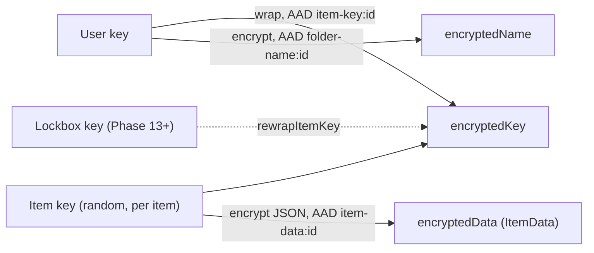

# Architecture

A map of the code **as built**, so you can go straight to the right file.
Update it whenever a file, route, model, job or package is added,
renamed or removed. The *target* design (key hierarchy, grants, clients)
is in `ref/design.md`.

Current state: accounts complete. Phases 1 (crypto core), 2 (auth API),
3 (web auth core), 4 (web MFA + recovery) and 5 (Settings → Security,
legal pages + gate) done and verified. Phase 6 (vault crypto + contract
in the shared packages) done and verified. Phase 7 (vault API) done
and verified. Phase 8 (web vault: store, 3-pane browsing, folders,
trash) done and verified. Phase 9 (item editor, generator popover, TOTP
from QR, conflict dialog) done and verified. Phases 10 (realtime sync over
Redis pub/sub + SSE), 11 (password health, generator page) and 12 (import
& export) done and verified: the personal vault is complete. Orgs next
(Phase 13).

## 1. System shape



Dashed = planned. The API is stateless and scales horizontally. Workers
scale separately. Both run the same modules.

## 2. Request path (API)



## 3. Repo layout

```
apps/
  api/            Fastify API + BullMQ worker (one package)
  web/            React 19 + Vite 8 + Tailwind 4 + React Router 7
  extension/      README only (Phases 20–23)
  mobile/         README only (Phases 31–34)
packages/
  types/          @repo/types: zod schemas + types shared by API and clients
  crypto/         @repo/crypto: all client crypto (libsodium + WebCrypto HKDF)
docker-compose.yml          Local Postgres :5433 + Redis :6380 + Mailpit (SMTP :1025, UI :8025)
docker/postgres/init/       First-start SQL (creates app_test)
.github/workflows/ci.yml    lint → typecheck → test (with Postgres + Redis) → build
turbo.json                  Task graph (db:generate runs before build/typecheck/test/dev)
tsconfig.base.json          Shared strict TS config (Bundler resolution)
biome.json                  Lint + format
```

Internal packages export TypeScript source (`"exports": "./src/index.ts"`).
There is no package build step. Vite bundles them for web, and tsup
bundles them for api (`noExternal: [/^@repo\//]`).

## 4. API (`apps/api`)

| File | Responsibility |
|---|---|
| `src/server.ts` | API entry: env → logger → Redis → `createModules` → seed legal docs → `buildApp` → listen; graceful shutdown |
| `src/worker.ts` | Worker entry: job schedules, runs the `maintenance` + `email` queues (SMTP delivery), ensures audit partitions on start |
| `src/app.ts` | `buildApp(options)`: Fastify instance from injected deps (logger, trust-proxy hops, health checks, optional `modules`). With modules: cookie → rate-limit → CSRF → auth hook, then auth/mfa/devices/legal routes. No env/DB imports, so tests build the real app |
| `src/modules.ts` | Composition root `createModules({db, redis, config, email, logger?, streams?})`: builds every module in dependency order. Used by API, worker, integration tests |
| `src/config/env.ts` | zod-validated env. Throws on startup listing every bad var. Imported only by entry points and `db/client.ts` |
| `src/config/security.ts` | `SecurityConfig` (app origin, RP ID, cookie Secure, keys, server hash params) + session/trust/token lifetimes |
| `src/config/legal/` | Published Terms/Privacy versions as TS (`terms.ts`, `privacy.ts`); immutable once seeded |
| `src/plugins/auth.ts` | Auth hook: cookie → `request.auth` (`user`, `session`, `tenant`, `step`, `pendingLegal`) and gates; route `config.auth` (`"public"` / `{allow}`); `requireAuth`, `actorOf` |
| `src/plugins/csrf.ts` | Double-submit CSRF check on unsafe methods; `issueCsrfToken` |
| `src/plugins/rate-limit.ts` | `@fastify/rate-limit` (Redis store); `rateLimits(app, rules)` preHandler for multi-key limits (`byIp`, `byEmail`, `byUser`) |
| `src/lib/secrets.ts` | Server-side: random tokens, SHA-256, HMAC, constant-time compare, Argon2id PHC hash/verify (`node:crypto`), dummy verifier, AES-256-GCM server secrets |
| `src/lib/totp.ts` | RFC 6238 TOTP, base32, otpauth URI |
| `src/lib/http.ts` | `requestMeta`, cookie names (`__Host-` when Secure) / options, `describeUserAgent` |
| `src/lib/actor.ts`, `src/lib/session-step.ts` | `Actor` (tenant/user/device/session); gate order `sessionStep()` |
| `src/db/errors.ts` | `isUniqueViolation` (Prisma P2002) |
| `src/db/client.ts` | **Only** place `PrismaClient` is built (Prisma 7 + `PrismaPg` adapter). Exports `db: DbHandles` (`writer`, `reader` = replica or writer) and `disconnectDb` |
| `src/db/types.ts` | `Db`, `DbHandles` types for repositories |
| `src/db/tenant.ts` | `Tenant` (`org` / `user`), `orgTenant`, `userTenant`, `tenantWhere` |
| `src/lib/errors.ts` | `AppError` + helpers (`badRequest`, `notFound`, …); `registerErrorHandling` maps AppError / ZodError / Fastify errors to `ErrorResponse`, unknown → 500 |
| `src/lib/logger.ts` | `createLogger`: pino JSON (pretty in dev) with secret redaction; shared by API and worker |
| `src/lib/redis.ts` | `redisOptionsFromUrl`, `createRedis`, `queueConnection` (BullMQ needs `maxRetriesPerRequest: null`) |
| `src/lib/shutdown.ts` | `onShutdown`: SIGINT/SIGTERM → cleanup, forced exit after 10s |
| `src/jobs/queues.ts` | `QUEUES`, `JOBS` names, `createQueue` with default retry/backoff/retention |
| `src/jobs/schedule.ts` | Job name → handler map + repeating schedules (cron, UTC) |
| `src/modules/health/routes.ts` | `GET /health` (liveness), `GET /health/ready` (dependency checks, 2s timeout each, 503 if any fail) |
| `src/modules/audit/` | `index.ts` (public: `createAuditModule`, types), `audit.service.ts` (`record`, `list`, `ensurePartitions`), `audit.repository.ts` (Prisma queries, audit tenant scoping) |
| `src/modules/users/` | User rows + cached per-request `UserState` (Redis `user:state:<id>`: status, security stamp, mfaEnabled) |
| `src/modules/sessions/` | Opaque session tokens: create, `validate` (Redis `sess:<hash>` + `sess:revoked:<hash>` marker, sliding idle), `peek` (liveness by token hash without sliding, for SSE heartbeats), revoke/revokeAll/revokeForDevice, list, cleanup |
| `src/modules/devices/` | Device cookie → device row, trust, `untrustAll` (account recovery), list/revoke; routes `/me/devices`, `/me/sessions` |
| `src/modules/legal/` | Seed + catalog (current/required version per key), `pending`, accept; routes `/legal/current`, `/me/legal/accept` |
| `src/modules/email/` | `EmailSender` (queue), templates, SMTP delivery (nodemailer) for the worker |
| `src/modules/mfa/` | TOTP (AES-GCM secret, replay-safe step), WebAuthn (`@simplewebauthn/server`, challenges in Redis), recovery codes (HMAC); routes `/me/mfa/*` |
| `src/modules/auth/` | prelogin, signup, verify email, login/logout, session response, change password, rotate recovery key, recovery (revokes every session, drops every device's trust); one-time tokens repo; routes `/auth/*`, `/me/password`, `/me/recovery-key` |
| `src/modules/realtime/` | Live vault updates (decisions §19). `realtime.hub.ts`: Redis pub/sub hub, `vaultChanged(userId, revision)` (publish after commit, best effort), `subscribeVault` (one lazily opened subscriber connection per instance, ref-counted per channel `vault:<userId>`). `realtime.routes.ts`: `GET /vault/events` SSE (`ready`, `vault {revision}`, `: ping` heartbeat with a non-sliding session re-check via `sessions.peek`, 1 h max lifetime, 10 streams/user, `preClose` ends streams). `index.ts`: `createRealtimeModule`, `StreamSettings`, `streamStillValid` |
| `src/modules/vault/` | Personal vault (decisions §16). `vault.repository.ts`: transaction queries (`bumpRevision` = upsert on `vault_state`, the per-user lock), REPEATABLE READ `snapshot` for sync, cross-user `findExpiredTrash` / `pruneTombstones` (raw SQL) for the job. `vault.service.ts`: `write()` (bump revision + run in one transaction, then announce via `VaultEvents`), sync (`syncSince`), item create/update (409 + `details.current`)/trash/restore/purge, folders, `importBatch`, `purgeExpired`. `vault.routes.ts`: `/vault/*`, body limits, per-user write/import rate limits |
| `prisma/schema.prisma` | Data model (Prisma 7: no `url` here, see `prisma.config.ts`) |
| `prisma/migrations/` | Versioned SQL migrations, applied by `prisma migrate deploy` |
| `prisma.config.ts` | Prisma CLI config (schema/migrations path, `DATABASE_URL`) |
| `src/generated/prisma/` | Generated client (gitignored; `pnpm db:generate`) |
| `test/app.test.ts` | App-level tests via `app.inject` with fake health checks |
| `test/integration/` | Real-Postgres tests, skipped unless `TEST_DATABASE_URL` is set. `auth.test.ts`, `vault.test.ts`, `realtime.test.ts` (two app instances, real HTTP SSE) (+ `harness.ts`: cookie-jar client, captured emails, `addInstance()`, stream settings) also need `TEST_REDIS_URL`. Files run one at a time (`fileParallelism: false`) |
| `test/setup/migrate-test-db.ts` | Vitest global setup: migrates the test DB; refuses if it equals `DATABASE_URL` |

### Routes

| Method + path | Module | Auth | Notes |
|---|---|---|---|
| `GET /health` | health | public | Liveness, never touches dependencies |
| `GET /health/ready` | health | public | `{status, checks: {database, redis}}` |
| `GET /auth/csrf` | auth | public | Sets CSRF cookie, returns token |
| `POST /auth/prelogin` | auth | public, RL ip+email | KDF params + salt (fake, stable for unknown emails) |
| `POST /auth/signup` | auth | public, RL | Always `verification_sent`; doesn't log in |
| `POST /auth/verify-email`, `/verify-email/resend` | auth | public, RL | |
| `POST /auth/login` | auth | public, RL ip+email | Sets session + device cookies; returns `SessionResponse` |
| `GET /auth/session`, `POST /auth/logout` | auth | any step | |
| `POST /auth/mfa/totp`, `/auth/mfa/webauthn/options`, `/verify` | auth | step mfa, RL | TOTP or recovery code; WebAuthn assertion |
| `POST /me/password`, `/me/recovery-key` | auth | ready, RL | |
| `POST /auth/recover/start`, `/complete` | auth | public, RL | |
| `GET /me/mfa`, `POST /me/mfa/totp/setup`, `/confirm`, `/webauthn/register/options`, `/verify` | mfa | mfa_setup or ready | |
| `DELETE /me/mfa/totp`, `/me/mfa/webauthn/:id`, `POST /me/mfa/recovery-codes` | mfa | ready | Last method can't be removed |
| `GET /me/devices`, `DELETE /me/devices/:id`, `GET /me/sessions`, `DELETE /me/sessions/:id` | devices | ready | |
| `GET /legal/current` | legal | public | |
| `POST /me/legal/accept` | legal | step legal | |
| `GET /vault/sync?since=` | vault | ready | Changes after `since` + tombstones, or `full` |
| `POST /vault/items`, `PUT /vault/items/:id` | vault | ready, RL user | Update needs `expectedRevision`; stale or trashed → 409 `details.current` |
| `DELETE /vault/items/:id`, `POST /vault/items/:id/restore` | vault | ready, RL user | Trash / restore (idempotent) |
| `DELETE /vault/items/:id/permanent` | vault | ready, RL user | Delete now + tombstone |
| `POST /vault/items/batch` | vault | ready, RL user (60/10 min) | Import ≤ 500 items + ≤ 500 folders, atomic |
| `POST /vault/exported` | vault | ready, RL user | Audit only: `vault.exported {format, itemCount}` (before the browser download) |
| `POST /vault/folders`, `PUT` / `DELETE /vault/folders/:id` | vault | ready, RL user | Delete moves items to no folder |
| `GET /vault/events` | realtime | ready, RL user (30/min), ≤ 10 open | SSE: `ready`, `vault {revision}`, heartbeat 25 s |

Another user's item or folder id is a 404 everywhere; a taken id on create
is a 409.

Gate order (decisions §11.18): session → user active → MFA verified (if set
up) → legal accepted → MFA set up. Errors `MFA_REQUIRED`,
`LEGAL_ACCEPTANCE_REQUIRED`, `MFA_SETUP_REQUIRED`, `CSRF_INVALID`.

The web app calls these as `/api/health…`. The Vite dev proxy strips
`/api`.

### Jobs (worker)

| Job | Queue | Schedule | Does |
|---|---|---|---|
| `audit.ensure-partitions` | `maintenance` | daily 03:00 UTC + on worker start | Creates audit partitions for this month + 3 ahead (idempotent) |
| `auth.cleanup` | `maintenance` | daily 03:30 UTC | Deletes sessions and one-time tokens dead for > 1 day |
| `vault.purge-trash` | `maintenance` | daily 04:00 UTC | Deletes items trashed > 30 days (tombstoned, one transaction per user), prunes tombstones > 90 days and raises `tombstone_floor` |
| `email.send` | `email` | on demand | Renders a template and sends via SMTP (Mailpit in dev); removed on completion |

## 5. Data model

| Model (table) | Purpose |
|---|---|
| `AuditLog` (`audit_log`) | Append-only action log. PK `(id, occurred_at)`. Indexed by org+time, actor+time, target. Org rows scoped by `org_id`; personal rows have `org_id` null and are scoped by `actor_user_id` |
| `User` (`users`) | Email, KDF params + salt, `auth_hash` (Argon2id of authKey), encrypted user key, public key, encrypted private key, recovery-wrapped user key, `recovery_auth_hash`, `security_stamp` |
| `Session` (`sessions`) | Token SHA-256, device, `mfa_verified_at`, stamp, idle/absolute expiry, revoked |
| `Device` (`devices`) | Per user + device-cookie hash; `trusted_until`, revoked |
| `MfaTotp` (`mfa_totp`) | AES-GCM secret, `confirmed_at`, `last_used_step` |
| `WebAuthnCredential` (`webauthn_credentials`) | Credential id, COSE key, sign count, transports |
| `MfaRecoveryCode` (`mfa_recovery_codes`) | HMAC of code, `used_at` |
| `OneTimeToken` (`one_time_tokens`) | `email_verify` / `account_recovery`, SHA-256, expiry, used |
| `LegalDocument` / `LegalAcceptance` | Immutable versions (key, version, body sha); acceptances per user (`signup`/`gate`) |

| `VaultItem` (`vault_items`) | Personal item: `type`, `folder_id`, `encrypted_key`, `encrypted_data`, `revision`, `deleted_at` (trash); `org_id` null until orgs. Index (`user_id`, `revision`) |
| `Folder` (`folders`) | Encrypted name, `revision` |
| `VaultState` (`vault_state`) | Per-user `revision` (its row lock serializes writes) + `tombstone_floor` |
| `VaultTombstone` (`vault_tombstones`) | Permanently deleted item/folder ids with the delete's revision; pruned after 90 days |

Migrations: `20261023000000_init` (audit), `20261028163103_accounts_auth`,
`20261029001017_vault`.

### Vault sync

```mermaid
sequenceDiagram
  participant C as Client
  participant S as vault.service
  participant DB as Postgres (writer)
  C->>S: write (e.g. PUT item, expectedRevision)
  S->>DB: BEGIN; upsert vault_state revision+1 (row lock)
  S->>DB: load item (tenant-scoped); stale/trashed → ROLLBACK, 409 details.current
  S->>DB: update row, revision = new; tombstone on permanent delete; COMMIT
  S-->>C: item as stored (+ audit after commit)
  C->>S: GET /vault/sync?since=R
  S->>DB: REPEATABLE READ: vault_state, then rows with revision > R
  Note over S: since missing, < tombstone_floor or > revision → full vault, no tombstones
  S-->>C: {revision, full, items, folders, deletedItemIds, deletedFolderIds}
```

Clients apply `items`/`folders`, then the tombstones, and keep `revision`
as the next `since`.

### Realtime (Phase 10)

```mermaid
sequenceDiagram
  participant W as Browser 1 (writes)
  participant A as API instance A
  participant R as Redis pub/sub
  participant B as API instance B
  participant L as Browser 2 (vault open)
  L->>B: GET /vault/events (cookie)
  B->>R: SUBSCRIBE vault:<userId> (first stream of this user on B)
  B-->>L: event: ready → client syncs
  W->>A: PUT /vault/items/:id
  A->>A: COMMIT (revision N)
  A->>R: PUBLISH vault:<userId> {"revision":N}
  R-->>B: message
  B-->>L: event: vault {"revision":N}
  L->>B: GET /vault/sync?since=… (any instance)
  loop every 25 s
    B->>B: sessions.peek + user state (no sliding); dead → end stream
    B-->>L: : ping
  end
```

The worker's purge job publishes the same way. Lost events are covered by
the client: it syncs on every (re)connect and polls every 60 s while the
stream is down.

### Audit partitioning



- Prisma manages only the `public` schema. Partitions and functions live
  in `audit_partitions`, so `prisma migrate dev` never tries to drop
  them.
- `UPDATE`/`DELETE` raise `audit_log is append-only`. Retention (later)
  = detach + drop whole partitions.
- An insert outside every partition's range fails, which is why the
  worker keeps 3 months ahead.

## 6. Web (`apps/web`)

| File | Responsibility |
|---|---|
| `index.html` + `public/theme-init.js` | Shell; sets the theme before first paint (external script, CSP-friendly) |
| `src/main.tsx` | Mounts `ThemeProvider` → `AuthProvider` → `RouterProvider` |
| `src/router.tsx` | Route table: auth layout (public, any-state, gate routes) + app routes behind `RequireApp` |
| `src/layout/AppShell.tsx` | Top bar (name, theme toggle, `UserMenu`), side nav, `<Outlet/>`, footer API status |
| `src/layout/UserMenu.tsx` | Account menu: email, Lock now (`keyStore.lock` → guard → `/lock`), Security settings, Sign out |
| `src/layout/AuthLayout.tsx` | Centered card for signed-out and gate pages (`wide` for legal); name, theme toggle, "Sign out" when a session exists |
| `src/crypto/worker.ts` | ES module Web Worker: every `@repo/crypto` account op (`createAccount`, `deriveLoginKeys`, `unlockWithEncKey`, `unlockWithPassword`, `changeMasterPassword`, `rotateRecoveryKey`, `startRecovery`, `completeRecovery`) and vault op (`decryptItems` / `decryptFolders` batches with per-entry failure, `encryptItem`, `encryptFolderName`, `totpCode`, `encryptImportBatch`, `encryptVaultExport` / `decryptVaultExport`). Wipes returned bytes after posting and byte args after use; errors cross as `{name, message}` |
| `src/crypto/client.ts` | `cryptoClient.call(op, ...args)`: typed RPC to one lazily started worker; `CryptoWorkerError`, `isDecryptionFailure` (wrong password) |
| `src/auth/keyStore.ts` | `createKeyStore({idleMs, timers})` + app singleton `keyStore`: user key in memory only, `set/get/isUnlocked/touch/lock/subscribe`, auto-lock after `AUTO_LOCK_MS`, lock zeroes the bytes |
| `src/auth/AuthProvider.tsx` | `useAuth()`: state `loading` / `signed_out` / `session{session, unlocked}`; `login`, `applySession`, `refresh`, `unlock`, `verifyPassword` (local re-prompt, no state change), `lock`, `logout`. Holds the login encKey until the session is `ready`. Signs out on `onUnauthorized`; activity (`pointerdown`/`keydown`) touches the key store |
| `src/auth/guards.tsx` | `targetFor(state)` (mfa → `/login/mfa`, legal → `/accept-terms`, mfa_setup → `/setup/mfa`, ready+locked → `/lock`); `RequireApp`, `RequireStep`, `PublicOnly`. UX only |
| `src/auth/passwordStrength.ts` | `estimateStrength(password, email)`: score 0–4, bits, suggestions, `meetsMinimum` |
| `src/auth/codes.ts` | `groupSecret` (TOTP key in 4s), `normalizeTotpCode`/`isTotpCode`, `normalizeRecoveryCode`/`isRecoveryCode` (input forgiveness before the `@repo/types` schemas) |
| `src/auth/webauthn.ts` | `registerSecurityKey(name)`, `verifyWithSecurityKey(trust)` (`@simplewebauthn/browser` ceremony + `mfaApi`), `securityKeyErrorMessage` (generic messages only), `browserSupportsWebAuthn` |
| `src/lib/saveText.ts` | `downloadText` (Blob), `printText` (iframe text node), `textFileName` |
| `src/lib/useLoad.ts` | `useLoad(fn)`: `{data, error, reload}` for an API call on mount |
| `src/components/markdownParser.ts` | Safe Markdown subset → block/inline tree (`parseMarkdown`, `parseInline`); `safeHref` keeps only absolute http/https/mailto (decisions §14.2). Not `markdown.ts`: on Windows `./Markdown` would resolve to it |
| `src/components/Markdown.tsx` | Renders the tree as React elements only (no `dangerouslySetInnerHTML`); links `target=_blank rel=noopener noreferrer nofollow` |
| `src/legal/useLegalDocuments.ts` | `GET /legal/current` → `{documents, error, reload}` (signup, legal page, gate) |
| `src/pages/legal/LegalPage.tsx` | `/legal/:key`: current version of Terms / Privacy, any auth state |
| `src/pages/auth/AcceptTerms.tsx` | Legal gate: card + checkbox per pending doc → `legalApi.accept` → `refresh()`; 400 with `currentVersions` → reload docs + session, ask again |
| `src/pages/settings/SettingsLayout.tsx`, `Section.tsx` | Settings tabs; `Section`, `Row`, `ConfirmButton` (inline "Sure?"), `formatDate` |
| `src/pages/settings/VaultData.tsx` | `/settings/vault` ("Import & export"): syncs the vault, then `vault/ImportSection` (format → file → preview → batched upload with progress) and `vault/ExportSection` (encrypted backup; CSV behind warning + checkbox + `verifyPassword`; `recordExport` before each download) |
| `src/pages/settings/Security.tsx` | `/settings/security`: loads MFA overview, devices, sessions (`useLoad`) and renders the sections in `security/` |
| `src/pages/settings/security/` | `TwoStepSection` (TOTP add/remove, security keys add/remove; last method disabled), `RecoveryCodesSection` (count, regenerate → `RecoveryCodes`), `DevicesSection` / `SessionsSection` (list, revoke; revoking the current one → `logout()`), `MasterPasswordSection` (worker `changeMasterPassword` → `POST /me/password` → `refresh()`), `RecoveryKitSection` (password → worker `deriveLoginKeys` for authKey + `rotateRecoveryKey(userKey)` → `POST /me/recovery-key` → `RecoveryKit`) |
| `src/components/ui.tsx` | `Button` (primary/secondary/link, `busy`), `Field` (label, hint, error, children), `Alert` |
| `src/components/StrengthMeter.tsx` | 4-segment bar + label + top suggestion |
| `src/components/RecoveryKit.tsx` | Shows a recovery key once (optional `title`, `intro`); download / print; "I've saved it" → `onDone` |
| `src/components/RecoveryCodes.tsx` | Shows MFA recovery codes once; download / print; "I've saved them" → `onDone` |
| `src/components/ResendVerification.tsx` | Resend verification email with a 30 s cooldown |
| `src/pages/auth/` | `Signup`, `CheckEmail`, `VerifyEmail`, `Login`, `Lock`, `SetupMfa` (TOTP QR via `qrcode` / security key → recovery codes → `refresh()` unlocks with the pending encKey), `MfaChallenge` (tabs from `session.mfaMethods`, trust device → `applySession`), `Recover` (worker `startRecovery` → `recoverStart` → new password → worker `completeRecovery` → `recoverComplete` → new kit → `/login`) |
| `src/theme/` | `theme.ts` (rules, storage key `app.theme`), `ThemeProvider.tsx` (`useTheme`), `ThemeToggle.tsx` |
| `src/components/ApiStatus.tsx` | Calls `/api/health/ready` and shows ok / degraded / offline |
| `src/pages/` | `Placeholder.tsx` (future pages), `NotFound.tsx` |
| `src/index.css` | Tailwind + design tokens (`--bg`, `--surface`, `--fg`, `--muted`, `--line`, `--accent`, `--ok`, `--bad`) for light and dark. Use `bg-surface`, `text-muted`… never raw colors |
| `src/config.ts` | Re-exports `APP_NAME` (from `@repo/types`); `AUTO_LOCK_MS`, `MIN_PASSWORD_LENGTH` |
| `src/api/client.ts` | `request()` (GET/POST/PUT/DELETE): credentials, CSRF header (refetch once on `CSRF_INVALID`), `ApiError`, `onUnauthorized` listeners, `errorMessage` |
| `src/api/auth.ts` | Typed endpoint calls (`authApi`, `mfaApi`, `devicesApi`, `legalApi`), responses parsed with `@repo/types` |
| `src/api/vault.ts` | `vaultApi`: sync, item create/update/trash/restore/purge, folder create/rename/delete |
| `src/vault/store.ts` | `createVaultStore({api, crypto, getKey})`: in-memory decrypted vault (`VaultEntry`, `FolderEntry`), `sync()` (since revision, merge / `full` replace, tombstones, coalesced, never rejects), `markUsed` (recent), `lock()` (drops everything, in-flight sync discarded). Decisions §17 |
| `src/vault/import/` | Import (decisions §21): `csv.ts` (RFC 4180 `parseCsv`, `csvRecords`, `toCsv`), `model.ts` (`RawItem` → validated `ImportedItem` via `addItem`; skipped / warnings), `csvFormats.ts` (generic, Bitwarden, 1Password, LastPass CSV; `ImportFormatError`), `jsonFormats.ts` (Bitwarden JSON, 1Password 1PUX via `fflate`), `index.ts` (`IMPORT_FORMATS`, `parseImportFile`, `planImport` → 500-item `ImportChunk`s reusing folders by name, `summarize`) |
| `src/vault/export.ts` | `selectForExport` (live, readable), `exportDocument` / `parseExportDocument` (re-import), encrypted file wrapper (`encryptedExportFile`, `readEncryptedExportFile`), `exportCsv` (Bitwarden CSV layout), `exportFileName` |
| `src/vault/health.ts` | Password health (decisions §20), pure: `computeHealth(entries, scorer)` → `{checked, weak, reusedGroups, old, issues}`; weak = score ≤ 2, reused = exact match, old = `passwordSetAt` (newest history `changedAt`, else `createdAt`) > 365 d; `userInputs`, `hasIssue`, `createScoreCache` (per `id:revision`) |
| `src/vault/strength.ts` | `loadPasswordScorer()`: zxcvbn-ts (core + common + en dictionaries) via dynamic import, once |
| `src/vault/useHealth.ts` | `useHealth()` → `{status, report}`; loads the scorer, cache cleared when the vault locks |
| `src/vault/live.ts` | `createLiveSync({open, sync, revision, timers})`: EventSource on `/vault/events`; `ready` → sync, `vault` → sync if newer; on error close, sync once, poll every 60 s, reconnect with backoff (1 s → 60 s, jitter). Status `off` / `connecting` / `live` / `offline`. Decisions §19 |
| `src/vault/search.ts` | `searchText` (index, no secrets), `normalize`, `VaultFilter` (incl. `health` weak/reused/old) + `parseFilter` / `filterParam` (`?view=`), `inFilter` / `filterItems` (health report optional), `countItems` |
| `src/vault/useVault.ts` | App singleton `vaultStore` (worker + `vaultApi` + `keyStore`; locks when the key store locks), `liveSync` (stops on lock) + `useLiveStatus()`, `useVault()` hook, `vaultActions` (`createItem`, `updateItem` against a base revision, `setFavorite` / `moveToFolder` last-write-wins, trash/restore/purge, folder create/rename/delete, `importChunks` (worker `encryptImportBatch` → `importBatch`, progress), `encryptExport` / `decryptExport`; each write then syncs), `ItemConflict` (409 → stored version + its decrypted data) |
| `src/vault/editorModel.ts` | Editor form model: `ItemDraft`, `emptyDraft`, `draftFromItem`, `buildItemData` (VAULT_LIMITS + encrypted-size check, merges into the stored loose data, password history), `nextPasswordHistory`, `changedFields` (conflict dialog), `encryptedLength` |
| `src/vault/totpInput.ts` | `parseTotpInput` (otpauth URI or bare base32 key → `TotpConfig` + issuer/account, readable errors), `prefillFromTotp`, `TotpSettings` |
| `src/vault/qr.ts` | `decodeQrImage` (jsQR), `startQrScan` (camera; BarcodeDetector or jsQR frames; returns stop), `cameraSupported`, `cameraErrorMessage`. Local only |
| `src/vault/clipboard.ts` | `copyText`: copy, then clear after 30 s (retried on next focus) |
| `src/vault/useReveal.ts` | Revealed fields of the open item; hide after 30 s, on blur, on hidden tab |
| `src/vault/useTotp.ts` | Live TOTP code (worker, once per period) + seconds remaining |
| `src/vault/devSeed.ts` | Dev only: `seedSampleVault()` (folder + 5 items via the real API) |
| `src/pages/vault/VaultPage.tsx` | `/vault` layout: Sidebar (+ `LiveIndicator`) · Catalog · `<Outlet/>`; sync on open and when the tab becomes visible; `liveSync` runs while mounted; one pane at a time below `lg` |
| `src/pages/vault/LiveIndicator.tsx` | Dot + "Live" / "Connecting…" / "Reconnecting…" (tooltip explains the 60 s fallback) |
| `src/pages/vault/useVaultParams.ts` | URL state `?view=` / `?q=` (`?type=` dropped from links), `itemHref`, `editHref`, `newHref`, `filterHref`, `homeHref`, `setQuery` |
| `src/pages/vault/Sidebar.tsx` | Filters with counts (all, favorites, types), folders (New / Edit → rename, delete), No folder, Trash; `TYPE_LABELS` |
| `src/pages/vault/Catalog.tsx` | Search box, "New" menu (item types), filtered item list |
| `src/pages/vault/ItemDetail.tsx` | `ItemRoute` (`/vault/:itemId`, keyed by id) → `ItemDetail`: fields, URIs (Open for http(s) only), notes, custom fields, TOTP, password history; Edit link, favorite star + folder picker (last-write-wins); trash / restore / delete now |
| `src/pages/vault/editor/ItemEditor.tsx` | `NewItemRoute` (`/vault/new?type=`, preselects the viewed folder), `EditItemRoute` (`/vault/:itemId/edit`, item checked once at start) → `ItemEditor`: type picker (new only), name/folder/favorite, username + password (Show, generator), TOTP, websites, notes, custom fields; save / conflict / unsaved-changes guard (`useBlocker` + beforeunload) |
| `src/pages/vault/editor/GeneratorPopover.tsx` | "Generate" panel: `GeneratorControls` + Use this / Regenerate / Cancel (`@repo/crypto/generator`) |
| `src/pages/vault/editor/TotpField.tsx` | Setup key input (pasted otpauth unpacked), Upload QR image, Scan with camera, advanced settings, live code |
| `src/pages/vault/editor/QrScanner.tsx` | Camera scan dialog; stops the stream on success / close / unmount / hidden tab |
| `src/pages/vault/editor/FieldLists.tsx` | `UrisEditor`, `CustomFieldsEditor` (text / hidden, show toggle) |
| `src/pages/vault/editor/ConflictDialog.tsx` | 409 dialog: changed there vs your changes; Save my version / Use theirs / Keep editing |
| `src/components/Dialog.tsx` | Modal on native `<dialog>` (`showModal`, Escape and backdrop → `onClose`) |
| `src/lib/useDismiss.ts` | Close a popover on outside pointer press or Escape |
| `src/pages/vault/FieldRow.tsx` | `FieldRow` (label, masked value, Show/Hide, Copy), `CopyButton` |
| `src/pages/vault/Dashboard.tsx` | `/vault` index: password health card (weak / reused / old counts → `?view=`), favorites, recently used, dev seed button |
| `src/components/GeneratorControls.tsx` | `useGenerator()` (options remembered until reload, value regenerated on change) + `GeneratorControls` (kind tabs, preview, entropy, options; slider caps per caller). Used by `GeneratorPopover` and `GeneratorPage` |
| `src/pages/generator/GeneratorPage.tsx` | `/generator`: full-range generator, Copy, Regenerate, "Copied this session" list |
| `src/pages/generator/history.ts` | `generatorHistory`: copied values (max 20, newest first), memory only, cleared on lock |

Web auth: Phases 3 (core), 4 (MFA + recovery pages) and 5 (Settings →
Security, legal pages + gate).

Auth flow (signup / login / unlock). Which page shows is decided only by
`targetFor(state)` in `guards.tsx`:





Reload → `GET /auth/session` → ready but locked → `/lock` →
`unlockWithPassword` in the worker (no server call).

| Path | Page | Guard | Phase |
|---|---|---|---|
| `/login`, `/signup` | Login, Signup | `PublicOnly` | 3 |
| `/recover` | Recover | `PublicOnly` | 4 |
| `/check-email`, `/verify-email` | CheckEmail, VerifyEmail (`#token=`) | none | 3 |
| `/lock` | Lock | `RequireStep` | 3 |
| `/login/mfa`, `/setup/mfa` | MfaChallenge, SetupMfa | `RequireStep` | 4 |
| `/accept-terms` | AcceptTerms | `RequireStep` | 5 |
| `/legal/:key` | LegalPage | none | 5 |
| `/` | → `/vault` | `RequireApp` | |
| `/vault` (`?view=`, `?q=`) | VaultPage → Dashboard | `RequireApp` | 8 |
| `/vault/:itemId` | VaultPage → ItemRoute | `RequireApp` | 8 |
| `/vault/new?type=` | VaultPage → NewItemRoute | `RequireApp` | 9 |
| `/vault/:itemId/edit` | VaultPage → EditItemRoute | `RequireApp` | 9 |
| `/vault?view=weak\|reused\|old` | VaultPage (health filter) | `RequireApp` | 11 |
| `/generator` | GeneratorPage | `RequireApp` | 11 |
| `/orgs` | Placeholder | `RequireApp` | 16 |
| `/settings` | → `/settings/security` | `RequireApp` | 5 |
| `/settings/security` | Security | `RequireApp` | 5 |
| `/settings/vault` | VaultData (import & export) | `RequireApp` | 12 |
| `*` | NotFound | `RequireApp` | |

Web vault (Phase 8): decrypted data lives only in `vaultStore`.



Item editor save (Phase 9, decisions §18):



## 7. Shared packages

| Package | Exports |
|---|---|
| `@repo/types` | Health, errors (+ gate codes), audit; `common.ts` (Email, Key32, Salt16, EncryptedBlob + `ENCRYPTED_BLOB_PATTERN`, Token, IdParams), `auth.ts` (KdfParams, prelogin/signup/login/session/password/recovery), `mfa.ts`, `devices.ts`, `legal.ts`, `brand.ts` (`APP_NAME`), `vault.ts` (see below) |
| `@repo/crypto` | Subpaths `@repo/crypto/generator`, `/otpauth`, `/totp` load no libsodium (safe on a UI thread). `ready()`; Argon2id `deriveMasterKey`, HKDF `deriveSubKeys` (WebCrypto); XChaCha20-Poly1305 `encrypt`/`decrypt` (`v1.xc20p.<nonce>.<ct>`, header bound as AAD); `wrapKey`/`unwrapKey` (optional `aad`); X25519 `generateKeyPair`, `seal`/`openSealed` (`v1.x25519sealed.<ct>`); recovery key (Crockford base32); account flows in `account.ts`; vault files below; known-answer vectors in `test/vectors/` |

Vault building blocks (Phase 6, decisions §15):

| File | What it does |
|---|---|
| `crypto/src/items.ts` | `encryptItem` / `decryptItem` (new random item key, or keep it on edit via the current `encryptedKey`), `wrapItemKey` / `unwrapItemKey`, `encryptItemData` / `decryptItemData` (JSON ↔ blob, returns `unknown`), `rewrapItemKey` (Phase 13 lockboxes), `encryptFolderName` / `decryptFolderName`. AAD `item-key:<id>` / `item-data:<id>` / `folder-name:<id>` |
| `crypto/src/totp.ts` | `totpCode(params, atMs)` (RFC 6238 via WebCrypto HMAC, SHA1/256/512, 6–8 digits, period 1–300), `totpSecondsRemaining`, `normalizeTotpSecret` (RFC 4648 base32), `TOTP_DEFAULTS` / `TOTP_LIMITS` |
| `crypto/src/otpauth.ts` | `parseOtpAuthUri` → `{secret, algorithm, digits, period, issuer, account}` (TOTP only, user-presentable `CryptoError`s), `formatOtpAuthUri` |
| `crypto/src/generator.ts` | `generatePassword` (sets, ambiguous filter, one per set), `generatePassphrase` (EFF long list), `generatedEntropyBits`, `randomInt` (rejection sampling on `crypto.getRandomValues`) |
| `crypto/src/vaultExport.ts` | `encryptVaultExport` / `decryptVaultExport`: whole export document under the user key, AAD `vault-export:v1` (account-bound backup, decisions §21) |
| `crypto/src/wordlist.ts` | `EFF_LONG_WORDLIST` (7,776 words; generated, source sha256 in header) |
| `types/src/vault.ts` | `VAULT_LIMITS`, `VAULT_RETENTION` (trash 30 d, tombstones 90 d); `ItemTypeSchema` (`login` / `note` / `totp`); decrypted `ItemDataSchema` (loose, defaults) + `itemDataSchemaFor(type)`, `TotpConfigSchema`, `CustomFieldSchema`, `FolderNameSchema`; wire `VaultItemSchema`, `FolderSchema`, item / folder create + update requests, `ItemConflictDetailsSchema` (409 `details.current`), `VaultSyncQuery/ResponseSchema` (tombstones, `full`), `VaultBatchImportRequest/ResponseSchema` (≤ 500, unique ids), `VAULT_EXPORT_FORMATS` + `VaultExportedRequestSchema` (audit) |



## 8. Config & environments

| Var (apps/api/.env) | Used by | Notes |
|---|---|---|
| `NODE_ENV`, `HOST`, `PORT`, `LOG_LEVEL` | server, worker | dev = pretty logs |
| `DATABASE_URL` | db/client, Prisma CLI | primary |
| `DATABASE_REPLICA_URL` | db/client | optional; unset = reads use primary |
| `REDIS_URL` | server, worker | `redis://` or `rediss://` |
| `TRUST_PROXY_HOPS` | app.ts | real proxy hop count; 0 ignores X-Forwarded-For |
| `APP_ORIGIN` | security config | Web origin: WebAuthn origin/RP ID, email links; https → Secure `__Host-` cookies |
| `SERVER_ENCRYPTION_KEY` | security config | 32 bytes base64; AES-GCM for TOTP seeds (until KMS) |
| `SERVER_HMAC_KEY` | security config | ≥ 32 bytes base64; fake prelogin salts, recovery code hashes |
| `MAIL_HOST`, `MAIL_PORT`, `MAIL_SECURE`, `MAIL_USER`, `MAIL_PASSWORD`, `MAIL_FROM` | worker | SMTP; dev = Mailpit (127.0.0.1:1025) |
| `TEST_DATABASE_URL` | integration tests | must differ from `DATABASE_URL` |
| `TEST_REDIS_URL` | integration tests | separate Redis DB number; flushed by the tests |

Deploy order: `pnpm db:deploy` (release step) → start API (`start`) and
worker (`start:worker`) processes. Node ≥ 24.7 (built-in `crypto.argon2`).
