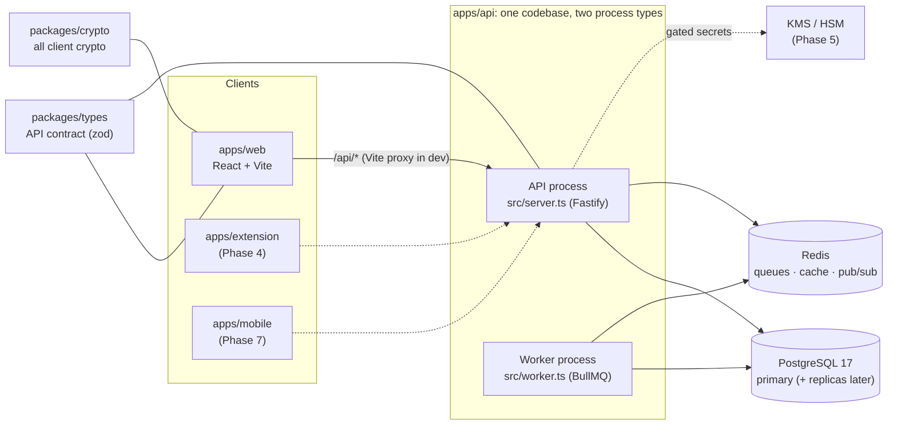
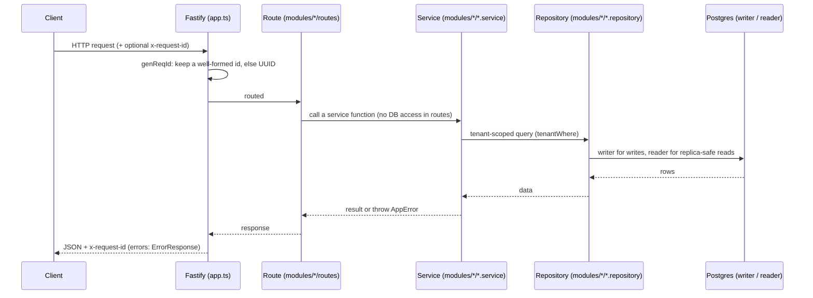
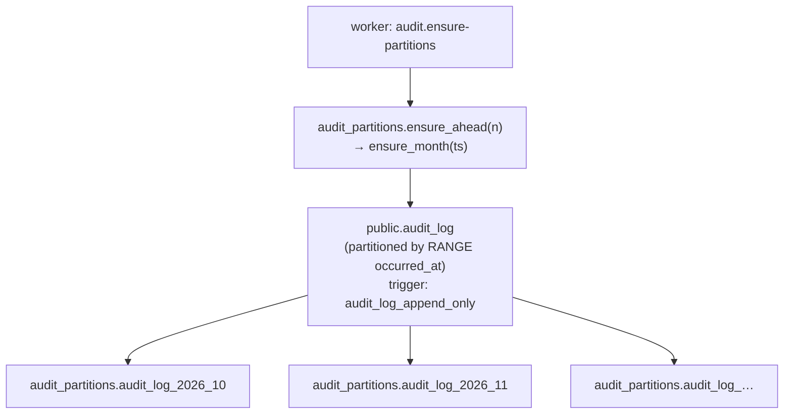

# Architecture

A map of the code **as built**, so you can go straight to the right file.
Update it whenever a file, route, model, job or package is added,
renamed or removed. The *target* design (key hierarchy, grants, clients)
is in `docs/design.md`.

Current state: **Phase 0 (foundation)**. Infrastructure only: no auth,
no vault yet.

## 1. System shape



Dashed = planned. The API is stateless and scales horizontally. Workers
scale separately. Both run the same modules.

## 2. Request path (API)



## 3. Repo layout

```
apps/
  api/            Fastify API + BullMQ worker (one package)
  web/            React 19 + Vite 8 + Tailwind 4 + React Router 7
  extension/      README only (Phase 4)
  mobile/         README only (Phase 7)
packages/
  types/          @repo/types: zod schemas + types shared by API and clients
  crypto/         @repo/crypto: client crypto (Phase 1); known-answer harness now
docker-compose.yml          Local Postgres :5433 + Redis :6380
docker/postgres/init/       First-start SQL (creates app_test)
.github/workflows/ci.yml    lint → typecheck → test (with Postgres) → build
turbo.json                  Task graph (db:generate runs before build/typecheck/test/dev)
tsconfig.base.json          Shared strict TS config (Bundler resolution)
biome.json                  Lint + format
```

Internal packages export TypeScript source (`"exports": "./src/index.ts"`).
There is no package build step. Vite bundles them for web, and tsup
bundles them for api (`noExternal: [/^@repo\//]`).

## 4. API (`apps/api`)

| File | Responsibility |
|---|---|
| `src/server.ts` | API entry: env → logger → Redis → `buildApp` → listen; graceful shutdown |
| `src/worker.ts` | Worker entry: registers job schedules, runs the `maintenance` queue, ensures audit partitions on start |
| `src/app.ts` | `buildApp(options)`: Fastify instance from injected deps (logger, trust-proxy hops, health checks). Request IDs, error handling, route registration. No env/DB imports, so tests build the real app |
| `src/config/env.ts` | zod-validated env. Throws on startup listing every bad var. Imported only by entry points and `db/client.ts` |
| `src/db/client.ts` | **Only** place `PrismaClient` is built (Prisma 7 + `PrismaPg` adapter). Exports `db: DbHandles` (`writer`, `reader` = replica or writer) and `disconnectDb` |
| `src/db/types.ts` | `Db`, `DbHandles` types for repositories |
| `src/db/tenant.ts` | `Tenant` (`org` / `user`), `orgTenant`, `userTenant`, `tenantWhere` |
| `src/lib/errors.ts` | `AppError` + helpers (`badRequest`, `notFound`, …); `registerErrorHandling` maps AppError / ZodError / Fastify errors to `ErrorResponse`, unknown → 500 |
| `src/lib/logger.ts` | `createLogger`: pino JSON (pretty in dev) with secret redaction; shared by API and worker |
| `src/lib/redis.ts` | `redisOptionsFromUrl`, `createRedis`, `queueConnection` (BullMQ needs `maxRetriesPerRequest: null`) |
| `src/lib/shutdown.ts` | `onShutdown`: SIGINT/SIGTERM → cleanup, forced exit after 10s |
| `src/jobs/queues.ts` | `QUEUES`, `JOBS` names, `createQueue` with default retry/backoff/retention |
| `src/jobs/schedule.ts` | Job name → handler map + repeating schedules (cron, UTC) |
| `src/modules/health/routes.ts` | `GET /health` (liveness), `GET /health/ready` (dependency checks, 2s timeout each, 503 if any fail) |
| `src/modules/audit/` | `index.ts` (public: `createAuditModule`, types), `audit.service.ts` (`record`, `list`, `ensurePartitions`), `audit.repository.ts` (Prisma queries, audit tenant scoping) |
| `prisma/schema.prisma` | Data model (Prisma 7: no `url` here, see `prisma.config.ts`) |
| `prisma/migrations/` | Versioned SQL migrations, applied by `prisma migrate deploy` |
| `prisma.config.ts` | Prisma CLI config (schema/migrations path, `DATABASE_URL`) |
| `src/generated/prisma/` | Generated client (gitignored; `pnpm db:generate`) |
| `test/app.test.ts` | App-level tests via `app.inject` with fake health checks |
| `test/integration/` | Real-Postgres tests, skipped unless `TEST_DATABASE_URL` is set |
| `test/setup/migrate-test-db.ts` | Vitest global setup: migrates the test DB; refuses if it equals `DATABASE_URL` |

### Routes

| Method + path | Module | Auth | Notes |
|---|---|---|---|
| `GET /health` | health | public | Liveness, never touches dependencies |
| `GET /health/ready` | health | public | `{status, checks: {database, redis}}` |

The web app calls these as `/api/health…`. The Vite dev proxy strips
`/api`.

### Jobs (worker)

| Job | Queue | Schedule | Does |
|---|---|---|---|
| `audit.ensure-partitions` | `maintenance` | daily 03:00 UTC + on worker start | Creates audit partitions for this month + 3 ahead (idempotent) |

## 5. Data model

| Model (table) | Purpose |
|---|---|
| `AuditLog` (`audit_log`) | Append-only action log. PK `(id, occurred_at)`. Indexed by org+time, actor+time, target. Org rows scoped by `org_id`; personal rows have `org_id` null and are scoped by `actor_user_id` |

### Audit partitioning



- Prisma manages only the `public` schema. Partitions and functions live
  in `audit_partitions`, so `prisma migrate dev` never tries to drop
  them.
- `UPDATE`/`DELETE` raise `audit_log is append-only`. Retention (later)
  = detach + drop whole partitions.
- An insert outside every partition's range fails, which is why the
  worker keeps 3 months ahead.

## 6. Web (`apps/web`)

| File | Responsibility |
|---|---|
| `index.html` + `public/theme-init.js` | Shell; sets the theme before first paint (external script, CSP-friendly) |
| `src/main.tsx` | Mounts `ThemeProvider` + `RouterProvider` |
| `src/router.tsx` | Route table |
| `src/layout/AppShell.tsx` | Top bar (name + theme toggle), side nav, `<Outlet/>`, footer API status |
| `src/theme/` | `theme.ts` (rules, storage key `app.theme`), `ThemeProvider.tsx` (`useTheme`), `ThemeToggle.tsx` |
| `src/components/ApiStatus.tsx` | Calls `/api/health/ready` and shows ok / degraded / offline |
| `src/pages/` | `Placeholder.tsx` (future pages), `NotFound.tsx` |
| `src/index.css` | Tailwind + design tokens (`--bg`, `--surface`, `--fg`, `--muted`, `--line`, `--accent`, `--ok`, `--bad`) for light and dark. Use `bg-surface`, `text-muted`… never raw colors |
| `src/config.ts` | `APP_NAME` placeholder |

| Path | Page | Phase |
|---|---|---|
| `/` | → `/vault` | |
| `/vault` | Placeholder | 2 |
| `/orgs` | Placeholder | 3 |
| `/settings` | Placeholder | 1 |
| `*` | NotFound | |

## 7. Shared packages

| Package | Exports |
|---|---|
| `@repo/types` | `HealthResponse(Schema)`, `HealthReadyResponse(Schema)`, `ErrorCode(Schema)`, `ErrorResponse(Schema)`, `AuditAction(Schema)` (`<domain>.<verb>`), `AuditEntry(Schema)` |
| `@repo/crypto` | `CRYPTO_FORMAT_VERSION`; `test/vectors/known-answer.json` + harness (cases come in Phase 1) |

## 8. Config & environments

| Var (apps/api/.env) | Used by | Notes |
|---|---|---|
| `NODE_ENV`, `HOST`, `PORT`, `LOG_LEVEL` | server, worker | dev = pretty logs |
| `DATABASE_URL` | db/client, Prisma CLI | primary |
| `DATABASE_REPLICA_URL` | db/client | optional; unset = reads use primary |
| `REDIS_URL` | server, worker | `redis://` or `rediss://` |
| `TRUST_PROXY_HOPS` | app.ts | real proxy hop count; 0 ignores X-Forwarded-For |
| `TEST_DATABASE_URL` | integration tests | must differ from `DATABASE_URL` |

Deploy order: `pnpm db:deploy` (release step) → start API (`start`) and
worker (`start:worker`) processes.
